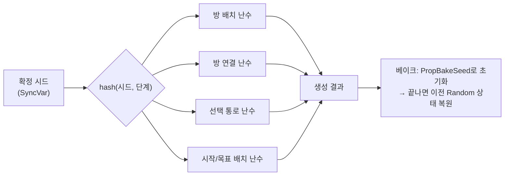
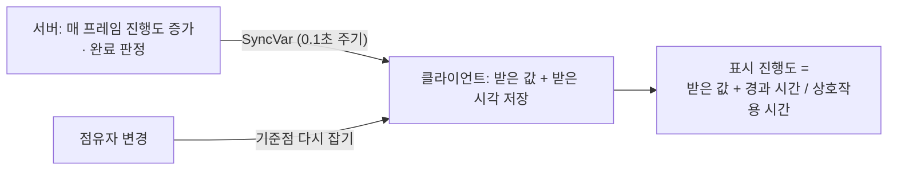

# Asymmetric PvP — Multiplayer Gameplay & 2D Procedural Map

백룸풍 실내에서 괴물 1명과 생존자 3명이 대결하는 2D 탑다운 비대칭 서바이벌 PvP의 멀티플레이 게임플레이와 절차적 2D 맵 생성입니다.

- **개발**: 5인 팀 (기획 2 · 프로그래밍 2 · 아트 1) / 프로그래머로 참여 · 팀 프로젝트 코드명 ProjectFS
- **기간**: 2026.05 ~ 2026.08
- **환경**: Unity 6 (URP), C#, FishNet (LAN 멀티플레이), UniTask
- 이 저장소는 팀 프로젝트 중 **본인이 담당한 코드**만 발췌했습니다.

## 핵심 문제 해결

### 1. 시드 동기화 맵 생성: 한 생성 단계를 고치면 다른 단계 결과까지 흔들리는 문제

**문제**: 맵 데이터 대신 시드 하나만 동기화하고 각 클라이언트가 같은 맵을 다시 만드는 구조입니다. 모든 단계가 난수 하나를 이어서 쓰면, 한 단계에서 난수를 한 번 더 뽑도록 고쳤을 때 뒤 단계의 결과까지 모두 바뀝니다.

**해결**: `MapSeedContext`가 `hash(기본 시드, 단계)`로 단계별 시드를 파생해, 방 배치·연결·선택 통로·시작/목표가 각자 독립된 난수를 씁니다. 알고리즘은 `UnityEngine.Random`을 직접 쓰지 않고 `IRandomSource`를 받아 테스트용 고정 난수로 바꿔 끼울 수 있습니다. 벽지·소품 베이크는 `UnityEngine.Random`을 쓰지만 생성 결과의 `PropBakeSeed`로 초기화하고 끝나면 이전 상태로 되돌립니다. 생성에 실패하면 서버가 시드를 바꿔 재시도하고, 확정된 시드로 SyncVar를 덮어씁니다.

**결과**: 선택 통로 단계의 난수 사용을 바꿔도 방 배치 결과는 그대로입니다. 그리드·방 목록 같은 큰 데이터는 전송하지 않고, 클라이언트는 확정된 시드로 첫 시도에 같은 맵을 만듭니다.

관련 코드: [`MapSeedContext.cs`](04_LevelGeneration_2D/Core/MapSeedContext.cs) · [`MapGenerationMasterRunner.cs`](04_LevelGeneration_2D/Runners/MapGenerationMasterRunner.cs) · [`TilemapBakeTestRunner.cs`](04_LevelGeneration_2D/Runners/TilemapBakeTestRunner.cs)

### 2. 서버 판정 상호작용: 0.1초 수신 주기 때문에 진행 바가 계단처럼 끊기는 문제

**문제**: 상자·탈출구처럼 붙잡고 있어야 끝나는 상호작용은 서버가 매 프레임 진행도를 올리고 완료도 서버가 판정합니다. 클라이언트는 전송 주기(0.1초)마다만 값을 받으므로, 받은 값을 그대로 표시하면 진행 바가 계단처럼 끊깁니다.

**해결**: 클라이언트는 마지막으로 받은 값과 받은 시각을 기준으로 `받은 값 + 경과 시간 / 상호작용 시간`을 외삽해 표시하고, 서버는 자기 값을 그대로 씁니다. 진행도가 0에서 0으로 "변경"될 때는 `OnChange`가 오지 않아 기준 시각이 낡은 채로 남으므로, 점유자가 바뀔 때도 기준점을 다시 잡습니다.

**결과**: 판정은 서버에 그대로 두면서 클라이언트의 진행 바는 끊기지 않고 이어집니다.

관련 코드: [`InteractableBase.cs`](01_EscapeSystem/Interaction/InteractableBase.cs)

## 구현 범위

- **탈출 시스템**: 금속 조각으로 상자에서 열쇠를 만들고(1단계) 열쇠로 탈출구를 여는(2단계) 흐름. 서버 판정 상호작용(한 명씩 점유, 피격 시 초기화), 목표 오브젝트 배치와 계층 동기화
- **괴물 캐릭터 Worm**: 플레이어가 조작하는 괴물의 FSM, 돌진·접촉 공격, 무력화·부활
- **생존자 추적**: 잠긴 상호작용을 시작한 생존자의 경로를 **괴물에게만** 노출(TargetRpc)하고 NavMesh로 렌더링, 근접 감지 센서와 HUD
- **2D 절차적 맵 생성**: 방 배치 → MST + 순환 경로 → 필수·선택 통로 → 막다른 길 정리 → 시작/목표 배치 → 검증 → 타일맵·NavMesh 베이크

## 코드 구성

| 폴더 | 설명 |
|---|---|
| `01_EscapeSystem` | `Interaction/`: 상호작용 베이스, 서버 검증과 SyncVar를 쓰는 잠금 상호작용, 탈출문, 상자. `Item/`: 아이템, 탄창 스포너. `ObjectiveStateController`: 목표 오브젝트 스폰과 계층 동기화. `EscapeDebuggingScene`: 탈출 흐름 디버그 씬 |
| `02_Worm` | Worm 상태(이동 · 돌진 준비/진행/경직 · 무력화) FSM, 돌진 타이머 시퀀스와 접촉 피해를 처리하는 무기 핸들러, 애니메이션 핸들러 |
| `03_SurvivorTracking` | 서버가 추적 대상·지속 시간·동시 추적 수를 관리하고 주기적으로 동기화합니다. 경로 렌더러, 근접 감지 센서가 있고, `UI/`에 HUD 위젯 연동이 있습니다. |
| `04_LevelGeneration_2D` | 2D 절차적 맵 생성 파이프라인 (아래 표) |
| `05_Shared` | 서버 전용 판정 체커(Ray / Circle / Box), 콜라이더 체커, 피격 깜빡임 효과, 늦게 접속해도 활성 상태가 맞춰지는 `RPCActivator`, `ITakeDamage` |

### 04_LevelGeneration_2D

| 폴더 | 설명 |
|---|---|
| `Rooms` | 방 배치 (버퍼 칸을 포함한 겹침 검사) |
| `Topology` | 방 거리 그래프로 최소 신장 트리(MST)를 만들고, 간선을 추가해 순환 경로를 최소 1개 보장 |
| `Corridors/Mandatory` | 문 후보 탐색, A\*로 필수 통로 생성, 통로 폭 확장 |
| `Corridors/Optional` | 선택 통로: 합류 · 순환(최소 길이 강제) · 막다른 길(랜덤 워크) · 확장형 막다른 공간 |
| `Corridors/Cleanup` | 막다른 길 정리 |
| `Pathfinding` | 통로 생성용 A\*. 비용 함수를 외부에서 주입하는 구조입니다(Vazgriz DungeonPathfinder2D 기반). |
| `Placement` | 방 인접 그래프, BFS를 두 번 돌려 그래프상 가장 먼 방을 시작/목표 후보로 배치 |
| `Validation` | Flood Fill로 모든 방에 도달 가능한지 검사하고 단계별 결과를 요약 |
| `Tilemap` | 생성 결과를 타일맵으로 베이크 |
| `Core` · `Grid` | 시드 컨텍스트, 난수 소스 추상화, 맵 그리드 |
| `Runners` | 단계별 테스트 러너. 마스터 러너는 생성에 실패하면 시드를 바꿔 다시 시도하고, 확정된 시드를 SyncVar로 동기화합니다. |

> 방 배치·MST·A\* 통로의 기본 골격은 Vazgriz의 절차적 던전 생성 글과 `DungeonPathfinder2D`를 참고했습니다.

## 기술 문서

내부 설계(네트워크 동기화 원칙, 맵 생성 파이프라인 단계별 알고리즘, 탈출 흐름, Worm 돌진 시퀀스, 생존자 추적)는 [기술 문서](docs/TechnicalDesign.md)에 정리했습니다.
