# ProjectFS Multiplayer & 2D Map — 기술 문서

[← README로 돌아가기](../README.md)

## 목차

1. [설계 목표](#1-설계-목표)
2. [네트워크 설계 원칙](#2-네트워크-설계-원칙)
3. [2D 절차적 맵 생성](#3-2d-절차적-맵-생성)
4. [탈출 시스템](#4-탈출-시스템)
5. [괴물 캐릭터 Worm](#5-괴물-캐릭터-worm)
6. [생존자 추적 시스템](#6-생존자-추적-시스템)
7. [공용 컴포넌트](#7-공용-컴포넌트)
8. [디버깅·검증 지원](#8-디버깅검증-지원)
9. [한계와 개선 방향](#9-한계와-개선-방향)

---

## 1. 설계 목표

| 목표 | 설계 방식 |
|---|---|
| 판의 공정성 | 상호작용 완료·피해·아이템 획득 같은 판정은 **서버만** 수행 |
| 맵 데이터 전송 최소화 | 맵 전체가 아닌 **시드 하나**만 동기화하고, 각 클라이언트가 같은 맵을 재생성 |
| 생성 결과 재현성 | 생성 단계별로 **독립 난수**를 파생해, 한 단계를 고쳐도 다른 단계 결과가 흔들리지 않게 함 |
| 플레이 가능한 맵만 사용 | 단계별 실패 사유를 기록하고, 조건을 못 맞추면 **시드를 바꿔 재시도** |
| 비대칭 정보 | 생존자 위치 정보는 **괴물 플레이어에게만** 전송 |
| 단계별 검증 가능성 | 생성 단계마다 **독립 실행 러너**와 기즈모를 두어 단계 단위로 확인 |

---

## 2. 네트워크 설계 원칙

FishNet 기반 LAN 호스트 구조입니다. 동기화 수단을 데이터 성격에 따라 나눠 썼습니다.

| 수단 | 쓰는 곳 | 이유 |
|---|---|---|
| `SyncVar` | 맵 시드, 상호작용 점유자·진행도, 상자/문 개방 여부, Worm 바라보는 방향 | 지속되는 상태. 늦게 들어온 클라이언트도 현재 값을 받음 |
| `SyncList` | 스폰된 오브젝트의 부모 계층 정보 | 개수가 변하는 목록 |
| `ServerRpc` | Worm 상태 변경 요청, 돌진 시작 통지, 방향 변경 | 클라이언트 → 서버 요청 |
| `ObserversRpc` (`BufferLast`) | 탈출구 활성화·위치 공개, 오브젝트 활성 상태 | 일회성 이벤트지만 늦게 접속한 클라이언트도 마지막 값을 받아야 함 |
| `TargetRpc` | 생존자 추적 경로 | **괴물 플레이어 한 명에게만** 보내야 하는 정보 |

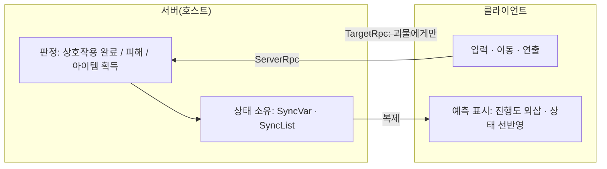

---

## 3. 2D 절차적 맵 생성

> 방 배치·MST·A\* 통로의 기본 골격은 Vazgriz의 절차적 던전 생성 글과 `DungeonPathfinder2D`를 참고했습니다. 이 저장소에서는 비용 함수 주입 구조, 단계별 결과 객체, 선택 통로·막다른 길 정리·시작/목표 배치·검증·베이크·네트워크 동기화를 새로 설계했습니다.

### 3.1 파이프라인

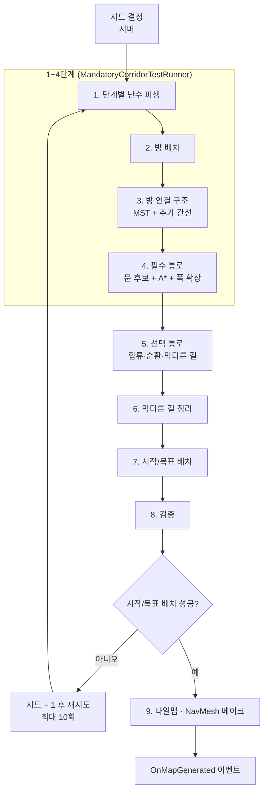

각 단계는 정적 클래스(`RoomPlacer`, `RoomTopologyBuilder` …)가 **입력 → 결과 객체**만 다루고, `MonoBehaviour` 러너가 설정값과 시각화를 맡습니다. 알고리즘 코드에 Unity 씬 의존이 없어 단계별로 따로 실행·검증할 수 있습니다.

| 결과 객체 | 내용 |
|---|---|
| `RoomPlacementResult` | 방 목록, 사용한 시도 횟수, 실패 사유 |
| `RoomTopologyResult` | 노드, MST 간선, 최종 선택 간선 |
| `MandatoryCorridorResult` | 통로별 중심선·확장 셀, 실패 사유 목록 |
| `OptionalCorridorResult` | 선택 통로 목록, 종류별 개수, 거절된 시도 수 |
| `DeadEndCleanupResult` | 남긴/제거한 막다른 길, 제거 사유, 최종 면적 비율 |
| `StartGoalResult` | 시작 방, 목표 후보, 그래프 거리, 직선 거리 비율 |
| `ValidationResult` | 도달 불가 방, 셀 통계, 단계별 요약, 최종 판정 |

### 3.2 시드와 난수 설계

```csharp
public IRandomSource GetSource(MapGenerationPass pass)
{
    if (!_passSources.TryGetValue(pass, out var source))
    {
        int derivedSeed = DerivePassSeed(BaseSeed, pass);   // hash(baseSeed, pass)
        source = new SystemRandomSource(derivedSeed);
        _passSources[pass] = source;
    }
    return source;
}
```

- **단계별 독립 난수**: 방 배치·연결·선택 통로·시작/목표가 각자 파생 시드의 난수를 씁니다. 예를 들어 선택 통로 단계에서 난수를 한 번 더 뽑도록 바꿔도 방 배치 결과는 그대로입니다.
- **`IRandomSource` 추상화**: 알고리즘은 `System.Random`이나 `UnityEngine.Random`을 직접 쓰지 않습니다. 테스트 시 고정 난수로 바꿔 끼울 수 있습니다.
- **베이크 난수 격리**: 벽지·소품 배치는 `UnityEngine.Random`을 쓰지만, 생성 결과에서 뽑은 `PropBakeSeed`로 초기화하고 끝나면 이전 상태로 되돌립니다. 다른 시스템의 난수 흐름을 오염시키지 않습니다.

### 3.3 방 배치 · 연결 구조

**방 배치** (`RoomPlacer`): 랜덤 위치·크기 후보를 만들고, 맵 경계 밖이거나 기존 방과 **버퍼(1칸)를 포함해** 겹치면 버립니다. 최소 개수(기본 6)를 못 채우면 실패 사유를 기록합니다.

**연결 구조** (`RoomTopologyBuilder`)

1. 방 중심 간 전체 쌍 거리 그래프를 만듭니다. 방이 많아질 때를 대비해 K-최근접 그래프로 바꿀 수 있습니다.
2. Prim 알고리즘으로 **최소 신장 트리(MST)** 를 구해 모든 방이 연결되게 합니다.
3. MST에 없는 간선을 일정 확률(기본 12.5%)로 추가합니다.
4. 추가 간선이 하나도 안 뽑혔으면 **가장 짧은 간선을 강제로 추가**해 순환 경로를 최소 1개 보장합니다.

```csharp
bool hasCycle = selectedEdges.Count > mst.Count;
if (!hasCycle && nodes.Count > 2)
{
    if (TryGetShortest(remainingEdges, out var shortest))
        selectedEdges.Add(shortest);
}
```

순환이 없는 트리 구조 맵에서는 괴물이 길목 하나만 지키면 생존자가 갇힙니다. 비대칭 추격 게임에서 **돌아갈 길**이 있도록 기획 요구사항을 코드로 강제했습니다.

### 3.4 필수 통로

간선마다 두 방을 잇는 통로를 만듭니다.

**문 후보** (`DoorCandidateFinder`)
- 상대 방을 **향하는 벽면**만 후보로 삼습니다(방향 벡터 내적 > 0).
- 통로 폭만큼 연속된 벽 칸이 모두 **모서리에서 최소 여백** 이상 떨어져 있어야 합니다. 방 모서리에 통로가 붙어 벽이 뾰족하게 깨지는 것을 막습니다.

**A\* 비용 함수 주입** (`DungeonPathfinder2D`): 경로 탐색기는 탐색만 하고, 비용은 호출하는 쪽이 넘깁니다.

```csharp
var path = pathfinder.FindPath(start, end, (a, b) => EvaluateCost(b, end, grid, config));
```

| 셀 종류 | 추가 비용 | 의도 |
|---|---|---|
| 기존 통로 | 1 | 이미 있는 통로를 **재사용**하도록 유도 → 통로가 자연스럽게 합류 |
| 빈 칸 | 5 | 새 통로 개척 |
| 방 내부 | 10 | 다른 방을 **관통하는 경로 회피** |

필수 통로와 선택 통로가 같은 탐색기를 쓰고, 비용 정책만 각자의 설정으로 넘깁니다.

**폭 확장** (`CorridorWidthExpander`): A\*가 만든 1칸 중심선을 진행 방향의 수직으로 넓혀 통로 폭(기본 3칸)을 만듭니다. 이미 방인 칸은 덮어쓰지 않고, 빈 칸만 통로로 표시합니다.

> 📷 **[S01]** 1~4단계 기즈모 — 방(빨강), MST 간선(흰색), 추가 간선(노랑), 통로 칸(청록)
>
> 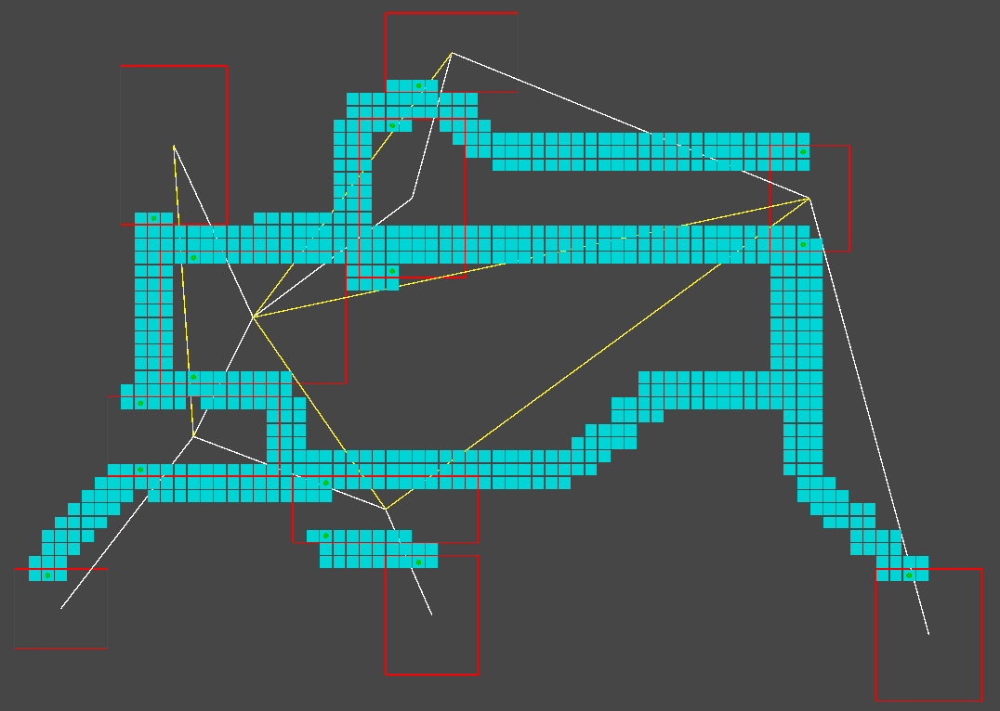

### 3.5 선택 통로

필수 통로만으로는 맵이 단조로워서, 기존 통로 칸에서 출발하는 선택 통로를 추가합니다. 시도마다 가중치 룰렛으로 종류를 고릅니다.

| 종류 | 가중치 | 생성 방식 |
|---|---|---|
| 방 연결 | 0.35 | 인접하지 않은 가장 가까운 방의 문 후보까지 A\* |
| 통로 합류 | 0.25 | 다른 임의 통로 칸까지 A\* |
| 순환 | 0.15 | 다른 통로 칸까지 연결하되 **최소 경로 길이 6** 강제 (짧은 고리 방지) |
| 막다른 길 | 0.20 | 랜덤 워크. 75% 확률로 직진해 직선 위주로 성장, 길이 5~18 |
| 확장형 막다른 공간 | 0.05 | 막다른 길 끝에 반경 2의 작은 공간 (방으로 분류하지 않음) |

통로를 찍을 때 **칸마다 소유 통로 ID**(`cellOwnerCorridorId`)를 기록합니다. 다음 단계에서 막다른 길을 지울 때 다른 통로와 공유하는 칸을 보존하는 데 씁니다.

### 3.6 막다른 길 정리

막다른 길이 너무 많으면 생존자가 쉽게 몰립니다. 세 가지 기준으로 순서대로 제거합니다.

| 순서 | 기준 | 기본값 |
|---|---|---|
| 1 | 길이 범위 위반 | 5 ~ 18칸 |
| 2 | **연속 분기 깊이** 초과 (막다른 길에서 또 갈라진 막다른 길) | 최대 2단계 |
| 3 | 전체 통로 면적 대비 막다른 길 면적 비율 초과 시, 큰 것부터 제거 | 30% |

```csharp
// 시작점이 다른 막다른 길 영역 안이면 그 위에서 분기한 것으로 보고 재귀적으로 깊이 계산
if (!cellOwnerCorridorId.TryGetValue(start, out int ownerId))
    return currentDepth;                                  // 방·필수 통로에서 시작 = 1단계
...
return ComputeBranchDepth(owner, ..., currentDepth + 1, visited);
```

제거할 때는 **그 막다른 길만 소유한 칸**만 비웁니다(`UnstampExclusiveCells`). 다른 통로와 겹친 칸을 지워 맵이 끊기는 일을 막습니다. 제거된 항목마다 사유 문자열을 남겨 튜닝할 때 근거로 씁니다.

> 📷 **[S02]** 막다른 길 정리 기즈모 — 남긴 막다른 길(초록), 제거한 막다른 길(빨강)
>
> 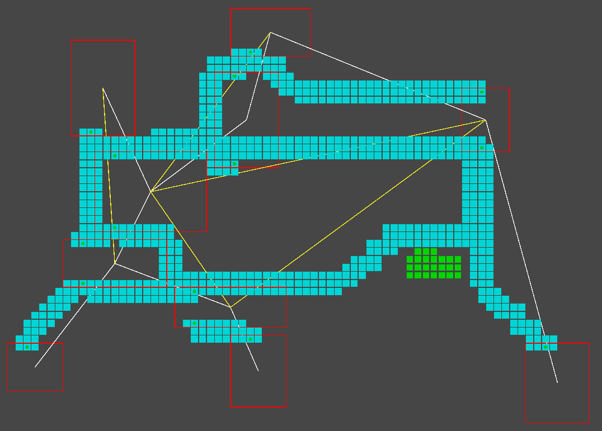

### 3.7 시작/목표 배치

생존자 시작 방과 탈출구 후보 방은 **멀리** 떨어져야 합니다. 방 연결 그래프에서 BFS를 두 번 돌려(더블 스윕) 그래프의 지름에 가까운 두 끝을 찾습니다.

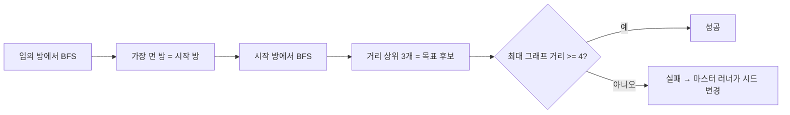

- 판정 기준은 **그래프 거리**(지나가야 하는 방 수)입니다. 직선 거리만 보면 가까워도 벽으로 막혀 실제 동선은 길 수 있기 때문입니다.
- 직선 거리 비율(맵 대각선 대비 40% 이상)은 성공 조건이 아니라 참고 지표로 기록합니다.
- 연결이 끊긴 그래프는 첫 BFS에서 바로 실패로 판정합니다.

### 3.8 검증

`MapValidator`가 최종 그리드를 검사하고 단계별 요약을 한곳에 모읍니다.

- **도달 가능성**: 첫 방에서 바닥 칸(방 + 통로)을 Flood Fill하고, 나머지 방이 모두 닿는지 확인합니다.
- **셀 통계**: 방 칸 수, 통로 칸 수, 통로/방 비율
- **실패 전파**: 필수 통로 실패, 시작/목표 미달 사유를 `[MandatoryCorridor]`, `[StartGoal]` 접두어로 합칩니다.
- **진단 기록**: `GenerationDiagnostics`에 통계와 실패 사유를 남깁니다.

### 3.9 베이크

`TilemapBakeTestRunner`가 그리드를 실제 맵으로 만듭니다.

1. 바닥 칸 전체에 바닥 타일을 먼저 깝니다.
2. 그 다음 벽을 배치합니다. 바닥이 다 깔린 뒤에 놓아야 Rule Tile이 이웃을 정확히 인식합니다.
3. 맵 외곽에 테두리 벽을 한 칸 더 둘러 맵 밖으로 나가지 못하게 합니다.
4. 방·통로에 붙은 벽 중 아래쪽이 바닥인 칸에 벽지를 확률적으로 배치합니다.
5. 방 내부에 소품을 배치합니다. 목표 오브젝트가 차지한 칸은 피하고, 소품 사이 최소 거리를 둡니다.
6. 모든 타일맵을 갱신하고 **NavMesh를 다시 굽습니다**(NavMeshPlus). 생존자 추적 경로가 이 NavMesh를 씁니다.

> 📷 **[S03]** 베이크된 맵 전체 탑뷰 (가능하면 시드 2~3개 비교)
>
> 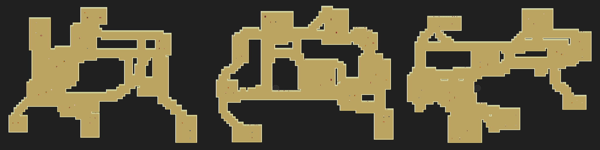

### 3.10 네트워크 동기화와 생성 이벤트

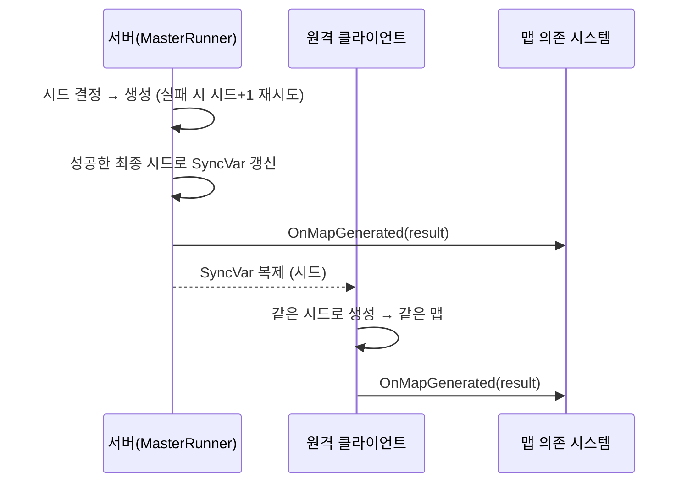

- 서버는 재시도 끝에 **확정된 시드**로 SyncVar를 덮어씁니다. 클라이언트는 그 시드로 첫 시도에 바로 성공하므로 재시도 과정을 다시 밟지 않습니다.
- 그리드·방 목록 같은 큰 데이터는 전송하지 않습니다.
- `m_hasGenerated` 플래그로 호스트(서버 + 클라이언트)에서 두 번 생성하지 않게 합니다.

> 📷 **[S04]** Console — `[MasterRunner] Attempt n/10 with Seed` 재시도와 최종 성공 로그
>
> 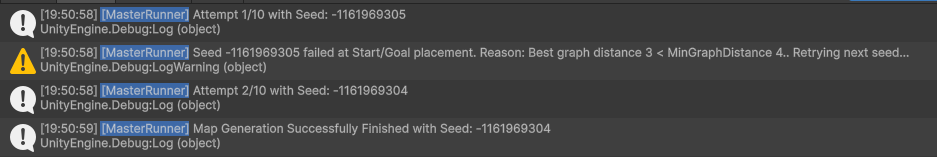

> 📷 **[S05]** MapGenerationMasterRunner 인스펙터 — 시드 설정과 단계별 러너 연결
>
> 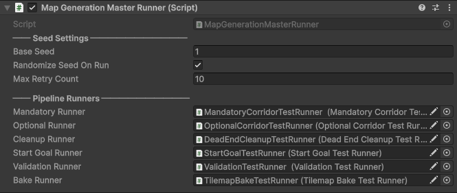

**초기화 순서와 무관하게 맵 결과를 받는 구조**

맵 생성 완료와 네트워크 시작(`OnStartServer`) 중 어느 쪽이 먼저 오든 동작해야 합니다. 맵에 의존하는 시스템은 같은 패턴을 씁니다.

```csharp
void OnEnable()
{
    MapGenerationMasterRunner.OnMapGenerated += OnMapGenerated;
    if (MapGenerationMasterRunner.LastResult != null)     // 이미 생성됐으면 즉시 처리
        OnMapGenerated(MapGenerationMasterRunner.LastResult);
}

void OnMapGenerated(MapGenerationResult result)
{
    _mapResult = result;
    if (IsServerStarted) ServerSetup();                  // 서버가 이미 떠 있으면 바로 배치
}

public override void OnStartServer()
{
    base.OnStartServer();
    if (_mapResult != null) ServerSetup();               // 맵이 먼저 왔으면 서버 시작 시 배치
}
```

---

## 4. 탈출 시스템

### 4.1 게임 흐름

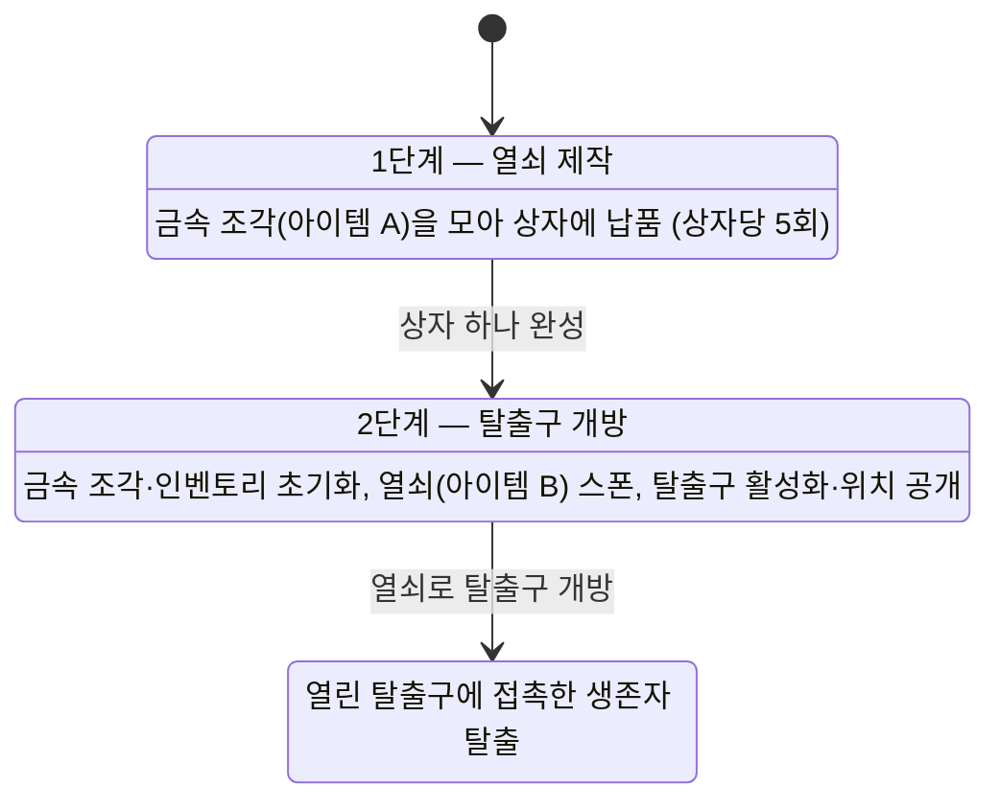

### 4.2 상호작용 기반 (`InteractableBase`)

상자·탈출구처럼 **일정 시간 붙잡고 있어야 완료되는** 상호작용의 공통 기반입니다.

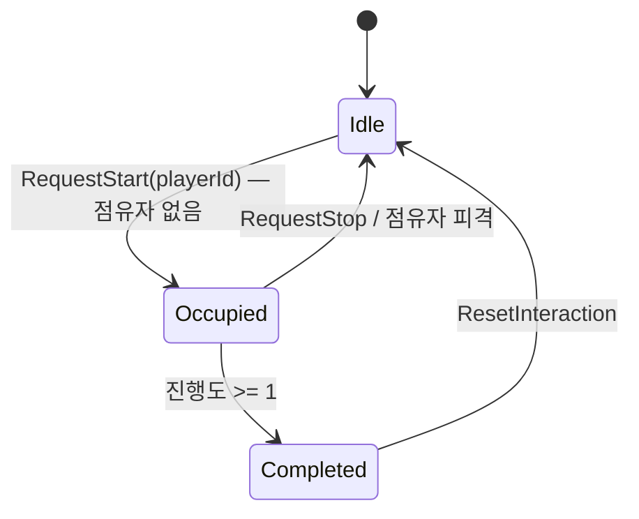

- **점유**: `_occupantId` SyncVar로 한 번에 한 명만 진행합니다. 동시에 시도하면 먼저 점유한 쪽만 인정됩니다.
- **피격 시 초기화**: 진행 중인 생존자가 맞으면 진행도가 0으로 돌아갑니다. 괴물의 견제 수단이 됩니다.
- **서버 진행**: 진행도는 서버에서만 매 프레임 증가하고, 완료 판정도 서버가 합니다.

**클라이언트 진행도 외삽**

서버는 매 프레임 진행도를 올리지만, 클라이언트는 전송 주기(0.1초)마다만 값을 받습니다. 받은 값 그대로 표시하면 진행 바가 계단식으로 끊깁니다. 그래서 마지막으로 받은 값과 받은 시각을 기준으로 외삽합니다.

```csharp
public float CurrentProgress
{
    get
    {
        if (IsServerInitialized) return Mathf.Min(1f, _currentProgress.Value);
        if (_occupantId.Value == -1) return 0f;

        float elapsed = Time.time - _syncedTime;
        return Mathf.Clamp01(_syncedProgress + elapsed / _interactionDuration);
    }
}
```

진행도가 0에서 0으로 "변경"되면 `OnChange`가 오지 않아 기준 시각이 낡은 채로 남습니다. 그래서 **점유자가 바뀔 때도 기준점을 다시 잡습니다.**

> 📷 **[S06]** 생존자가 상자와 상호작용하는 중 — 진행 바와 안내 문구
>
> 

### 4.3 잠긴 상호작용 (`LockedInteractable`)

필요 아이템이 있어야 시작되는 상호작용입니다.

- **서버 검증**: `RequestStart`에서 서버가 접속 정보로 해당 플레이어의 인벤토리를 찾아 아이템 보유를 다시 확인합니다.
- **클라이언트 안내**: `IsInteractable`이 같은 기준으로 판정해 안내 문구를 막습니다. 클라이언트 판정은 UI용이고, 최종 판정은 서버입니다.
- **완료 처리**: 열림 상태를 SyncVar로 설정하고 아이템을 소모합니다.
- **위치 노출 연동**: 점유에 성공하는 순간 괴물에게 해당 생존자의 이동 경로를 노출합니다(6장). 목표 진행이 곧 위험 노출이 되도록 설계했습니다.

| 하위 클래스 | 완료 조건 | 완료 후 |
|---|---|---|
| `EscapeChest` | 금속 조각 납품 횟수가 목표(5)에 도달 | 열림 → 2단계 시작 |
| `EscapeDoor` | 열쇠를 가지고 1회 개방 | 열린 문 스프라이트, 접촉한 생존자 탈출 처리 |

### 4.4 목표 오브젝트 배치 (`ObjectiveStateController`)

맵 생성이 끝나면 서버가 목표 오브젝트를 배치합니다.

| 오브젝트 | 위치 규칙 |
|---|---|
| 탈출구 | 목표 후보 방 중 하나의 중심. **비활성 상태로 스폰** |
| 상자 (3개) | 방을 섞은 뒤 서로 다른 방의 내부 칸 |
| 금속 조각 (아이템 A, 5개) | 벽에서 1칸 이상 떨어진 바닥 칸 |
| 열쇠 (아이템 B) | 2단계 시작 시 스폰. 탈출구에서 **최소 15칸** 떨어진 바닥 칸. 조건을 만족하는 칸이 없으면 임의 배치 후 경고 |

- 모든 배치는 이미 놓인 오브젝트와 최소 반경(2) 이상 떨어지도록 점유 위치 목록으로 관리합니다. 이 목록은 소품 베이크에도 넘겨 소품이 목표물과 겹치지 않게 합니다.
- 탈출구 공개는 `ObserversRpc(BufferLast = true)`로 보냅니다. 늦게 접속한 클라이언트도 방향 UI에 탈출구 위치를 받습니다.
- 2단계로 넘어갈 때 **접속한 모든 클라이언트**의 인벤토리를 비웁니다. 로컬 연결만 보면 호스트 한 명만 초기화되는 문제를 피하려고 서버의 전체 연결 목록을 순회합니다.

**스폰 오브젝트 계층 동기화**

FishNet으로 스폰한 오브젝트는 클라이언트에서 씬 루트에 생깁니다. 서버에서 정리한 부모 계층(아이템 A / 아이템 B / 상자 / 탈출구 루트)을 클라이언트에서도 유지하려고, `(ObjectId, RootIndex)` 목록을 `SyncList`로 동기화합니다.

```csharp
public struct PropParentData { public int ObjectId; public int RootIndex; }
private readonly SyncList<PropParentData> _parentDataList = new();
```

목록이 오브젝트 스폰보다 먼저 올 수도, 늦게 올 수도 있으므로 세 경로를 모두 처리합니다.

| 경로 | 처리 |
|---|---|
| 목록 항목 추가 (`OnChange`) | 이미 스폰된 오브젝트면 바로 부모 지정 |
| 오브젝트 스폰 (`OnSpawnedAdd`) | 목록에 해당 ID가 있으면 부모 지정 |
| 클라이언트 시작 시 | 기존 목록 전체를 한 번 적용 |

---

## 5. 괴물 캐릭터 Worm

### 5.1 구성

`Worm`이 조립자 역할을 하고, 기능별 객체에 설정과 의존성을 주입합니다.

| 구성 요소 | 역할 |
|---|---|
| `WormFSM` | 상태와 이동·돌진·조준 가능 여부 판정 |
| `WormLocomotion` | 입력 → 이동, 감속 효과 |
| `WormWeaponHandler` | 돌진 시퀀스, 돌진·접촉 피해 |
| `WormAnimationHandler` | 8방향 애니메이션, 방향 변경 이벤트 |
| `EntityHealth` | 피격·무력화·부활 이벤트 |
| 추적 컴포넌트 | 경로 노출, 근접 감지 (6장) |

입력 구독·카메라 등록·업데이트 구독은 **오너 클라이언트에서만** 합니다. 다른 클라이언트에서는 리지드바디를 Kinematic으로 바꿔 물리 충돌로 위치가 어긋나지 않게 합니다.

### 5.2 상태 머신

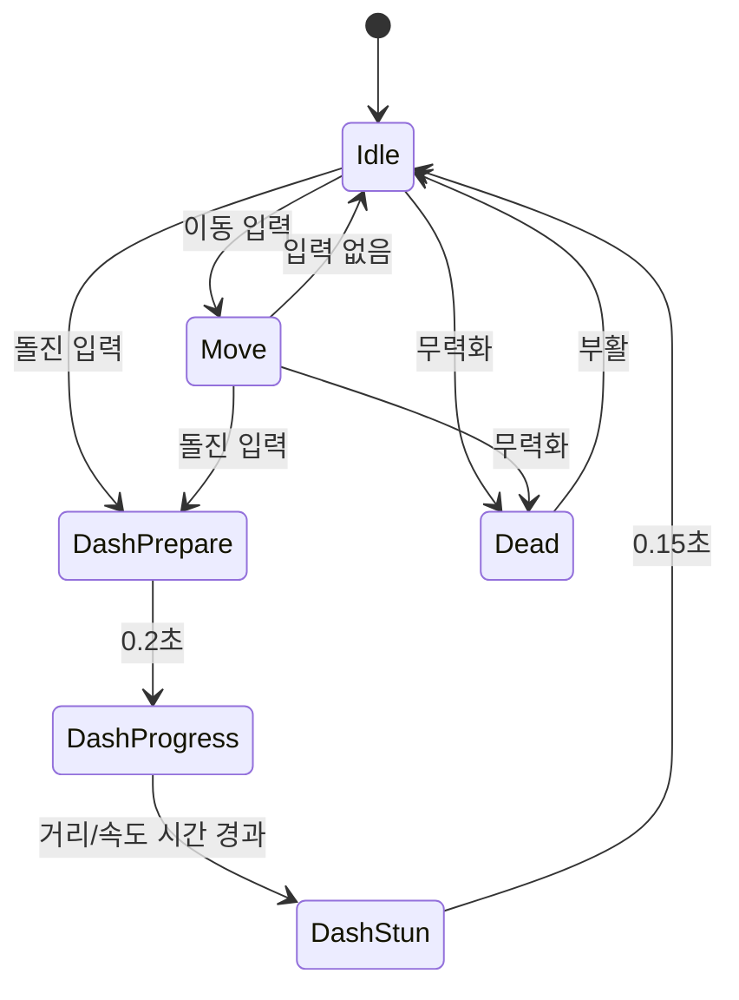

상태별 제약을 프로퍼티로 모았습니다.

| 프로퍼티 | 막히는 상태 |
|---|---|
| `IsMovementBlocked` | 돌진 준비·진행·경직, 무력화 |
| `IsDashBlocked` | 돌진 준비·진행·경직, 무력화 |
| `IsAimRotationBlocked` | 돌진 준비·진행·경직 |

**상태 변경 예측**: 오너가 클라이언트면 자기 화면의 상태를 먼저 바꾸고 서버에 요청합니다. 입력 반응이 네트워크 지연을 기다리지 않습니다. 호스트에서는 전이 가능 여부(무력화 상태는 부활로만 빠져나올 수 있음)를 검사한 뒤 바로 반영합니다.

### 5.3 돌진

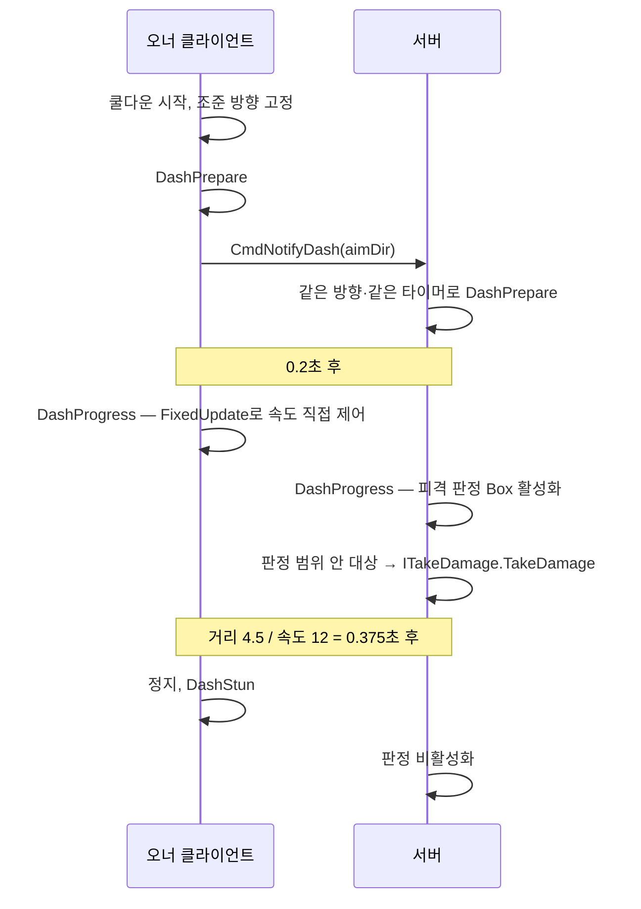

- **역할 분리**: 이동은 물리 바디를 가진 오너가 구동하고, 피격 판정은 서버가 합니다. 서버는 오너가 보낸 방향으로 같은 타이머 시퀀스를 돌려 판정 시점을 맞춥니다.
- **방향 고정**: 입력 시점의 조준 방향으로 고정해, 돌진 도중 마우스를 움직여도 궤적이 바뀌지 않습니다.
- **물리 스텝 구독**: 돌진 중에만 `FixedUpdate` 옵저버를 구독하고, 끝나면 바로 해제합니다.
- **타이머 체인**: `CountdownTimer`의 종료 이벤트를 다음 단계 시작에 연결해 준비 → 진행 → 경직을 이어 붙였습니다. 진행 시간은 `거리 / 속도`로 계산하고, 속도 0 나눗셈을 막습니다.

### 5.4 판정 각도 동기화

돌진·접촉 판정 Box는 몸체 회전을 따라갑니다. 서버의 Box 각도가 화면과 다르면 맞은 것처럼 보이는데 피해가 없는 일이 생깁니다. 그래서 8방향 바라보는 방향을 `SyncVar`로 동기화하고, 모든 피어가 같은 각도로 콜라이더를 회전시킵니다.

```csharp
private void OnOwnerDirChanged(DirectionResolver.EightDir dir)
{
    SetColliderRotation(dir);                 // 오너 화면 즉시 반영
    if (IsServerInitialized) _facing.Value = dir;
    else CmdSetFacing(dir);                   // 서버가 SyncVar로 전파
}
```

> 📷 **[S07]** Scene 뷰 — Worm 돌진 판정 Box 기즈모가 바라보는 방향으로 회전된 모습
>
> 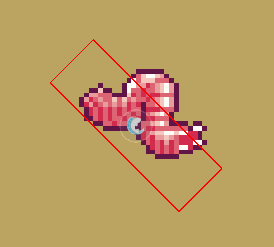

### 5.5 피격 · 무력화 · 부활

| 이벤트 | 처리 |
|---|---|
| 피격 | 깜빡임 연출, **오너만** 이동 속도 감소 적용 (감소율 30%, 1.5초) |
| 무력화 | 무력화 애니메이션, 상태 강제 전환, 정지, 감속 해제. 추적·감지 표시 차단 |
| 부활 (10초 후) | 부활 애니메이션, Idle로 복귀, 감속 해제 |

### 5.6 수치 설정 (`MonsterConfig`)

Odin `BoxGroup`으로 부활 / 탄환 피격 감속 / 접촉 피해 / 돌진(피해·이동·타이밍) / 감지 및 추적을 묶었습니다. 디버깅용 `MonsterStatOverride`를 켜면 설정 SO를 건드리지 않고 런타임에 돌진·피해 수치를 바꿀 수 있습니다.

> 📷 **[S08]** MonsterConfig 인스펙터 — BoxGroup으로 묶인 수치
>
> 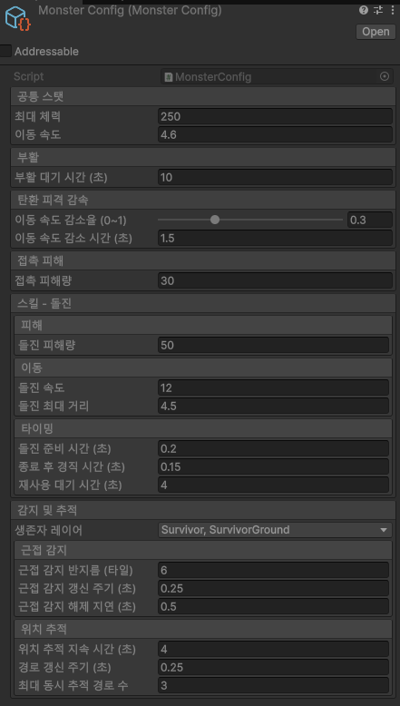

---

## 6. 생존자 추적 시스템

### 6.1 이동 경로 노출 (`EntityPathRevealController` + `EntityPathRenderer`)

생존자가 잠긴 상호작용(상자·탈출구)을 시작하면, 괴물에게 그 생존자까지의 경로가 일정 시간 보입니다.

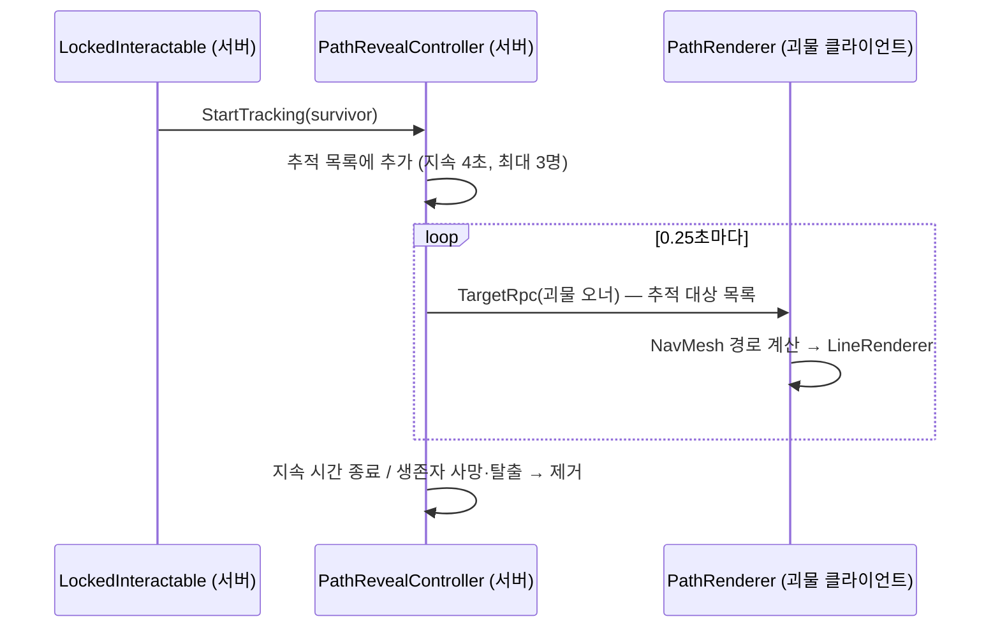

**서버: 추적 대상 관리**
- 같은 생존자를 다시 추적하면 새로 만들지 않고 **지속 시간만 갱신**합니다.
- 동시 추적 수(3)를 넘으면 무시합니다.
- 생존자 사망 이벤트에 일회성 핸들러를 걸어 즉시 제거하고, 핸들러는 실행되면서 스스로 구독을 해제합니다.
- 괴물이 무력화 상태면 경로 표시를 지웁니다.
- 전송 대상은 `TargetRpc`로 **괴물 오너 한 명**입니다. 생존자 클라이언트에는 이 정보가 아예 가지 않습니다.

**클라이언트: 경로 렌더링**
- 서버는 경로가 아니라 **대상 목록만** 보냅니다. 경로 계산은 괴물 클라이언트가 베이크된 NavMesh로 합니다. 경로 꼭짓점 배열을 네트워크로 보내지 않아도 됩니다.
- LineRenderer는 최대 추적 수만큼 미리 만들어 재사용합니다.
- 갱신 사이에 알파를 줄여 **맥박처럼 깜빡이는** 연출을 넣었습니다. 알파는 `MaterialPropertyBlock`으로 바꿔 머티리얼 인스턴스를 만들지 않습니다.

> 📷 **[S09]** 괴물 화면 — 상호작용 중인 생존자까지 경로 라인이 표시된 모습
>
> 

### 6.2 근접 감지 (`EntityProximitySensor`)

괴물 주변 반경 6칸 안에 생존자가 있는지를 서버가 판정합니다.

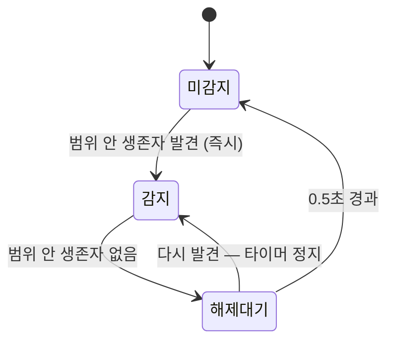

- **주기 판정**: 매 프레임이 아니라 0.25초마다 코루틴으로 `OverlapCircle`을 실행합니다.
- **해제 지연**: 감지는 즉시, 해제는 0.5초 뒤에 합니다. 경계에서 들락날락할 때 HUD가 깜빡이는 것을 막습니다.
- **변경 시에만 전송**: 상태가 바뀔 때만 RPC를 보냅니다.

> 📷 **[S10]** 근접 감지 HUD 위젯이 켜진 화면 (가능하면 Scene 뷰 감지 반경 기즈모 함께)
>
> 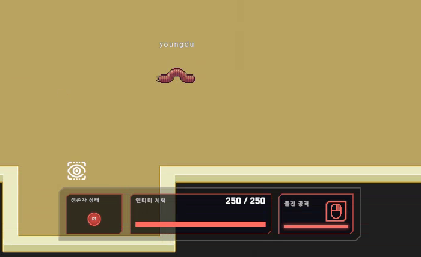

### 6.3 HUD 연결 (Provider / Adapter / Widget)

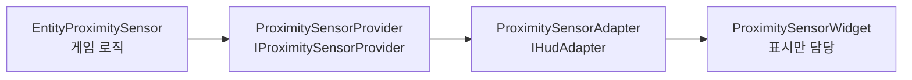

- 위젯은 `SetVisible(bool)`만 알고, 게임 로직을 모릅니다.
- 어댑터는 연결 시 **현재 상태를 즉시 한 번 적용**합니다. 중간에 HUD가 붙어도 상태가 맞습니다.
- 연결 해제 시 구독을 풀고 위젯을 숨겨 이벤트 누수를 막습니다.
- HUD 공통 인터페이스(`IHudProvider`, `IHudAdapter`)에 맞춰, 다른 HUD 요소와 같은 방식으로 붙습니다.

---

## 7. 공용 컴포넌트

| 컴포넌트 | 역할 |
|---|---|
| `RaycastChecker` | Ray / Circle / Box 판정 프리셋. **서버에서만** `FixedUpdate`로 판정하고, 일정 시간만 켜는 기능 제공. 기즈모로 판정 범위 표시 |
| `ColliderChecker` | 트리거 콜라이더 기반 판정. 일정 시간 활성화 지원 |
| `SpriteBlink` | 피격 깜빡임 연출 |
| `RPCActivator` | 활성 상태를 `BufferLast` RPC로 전파 → 늦게 접속해도 현재 활성 상태 반영 |
| `ITakeDamage` | 피해를 받는 대상의 공통 인터페이스. 돌진 판정이 대상 타입을 몰라도 피해 적용 가능 |

---

## 8. 디버깅·검증 지원

| 도구 | 내용 |
|---|---|
| 단계별 러너 | 1~4단계, 선택 통로, 막다른 길 정리, 시작/목표, 검증, 베이크를 각각 `ContextMenu`로 단독 실행 |
| 마스터 러너 | `Run Full Pipeline`으로 에디터에서 전체 파이프라인 실행. 시도 횟수·시드·실패 사유를 로그로 출력 |
| 기즈모 | 방(빨강), MST 간선(흰색)과 추가 간선(노랑), 통로 칸(청록), 남긴/제거한 막다른 길(초록/빨강) |
| 스파이크 검증 | `TestRoomFixtures`로 경계 사례(통로보다 좁은 방, 45° 대각선 배치, 근접한 제3의 방, 맵 반대편 모서리)를 고정하고 `SpikeValidator`로 통로 연결성 확인 |
| 진단 기록 | `GenerationDiagnostics`에 단계별 통계와 실패 사유 누적 |
| 스탯 오버라이드 | `MonsterStatOverride`로 런타임에 Worm 수치 조정 |
| 전용 씬 | `EscapeDebuggingScene`: 입력·플레이어·투사체만 초기화해 탈출 흐름만 검증 |

---

## 9. 한계와 개선 방향

| 항목 | 현재 | 개선 방향 |
|---|---|---|
| 재시도 판정 | 시작/목표 배치 성공만 보고 재시도. 검증 단계의 도달 불가 방은 재시도 조건에 없음 | `ValidationResult.Success`까지 재시도 조건에 포함 |
| 서버 로직의 클라이언트 콜백 의존 | 상자 완료 → 2단계 전환이 클라이언트 측 `OnOpened` 콜백으로 연결됨. 호스트에서는 동작하지만 전용 서버에서는 호출되지 않음 | 서버 측 SyncVar 변경 콜백에서 2단계 전환 |
| Worm 상태 복제 | 원격 클라이언트의 상태 요청을 서버가 전이 검증 없이 반영. 서버 상태 값이 다른 클라이언트에 복제되지 않음 (애니메이션은 NetworkAnimator로 동기화) | 서버 검증 후 SyncVar로 복제 |
| 문 후보 선택 | 유효 후보 중 첫 번째를 사용 | 상대 방과의 거리·각도로 후보 점수화 |
| A\* 열린 목록 | 매 반복 `List.Sort` | 우선순위 큐로 교체 |
